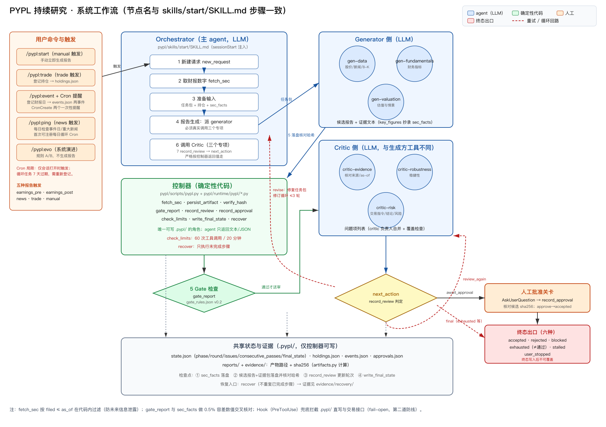
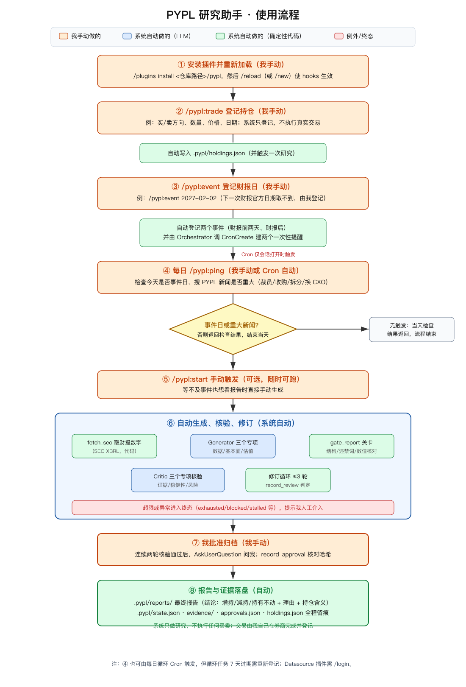

# PYPL 持续研究助手 · 《金融人工智能编程》期末作业

## 1. 个人信息

- 姓名：于欣荷
- 学号：25260660029
- 课程：《金融人工智能编程》2026 年秋季
- 项目：一个持续研究美股 PayPal（PYPL）的 Kimi Code 插件，对应课上的「长程智能体工作流 / 完整架构」作业要求。

## 2. 任务概述

为持有 PYPL 的个人投资者（我自己）提供一个持续研究助手：登记我的持仓变化和财报日程，跟踪重大新闻，按五种触发条件生成结构化的研究观点报告。每份报告必须给出明确结论（增持 / 减持 / 持有不动）、至少三条理由、对当前持仓的含义和风险提示；报告送 Critic 独立核验，修订循环最多 3 轮，连续两轮通过后经我批准才归档。系统**只做研究，不执行任何买卖**——交易由我在券商完成，系统只负责登记。

架构对照课上的完整架构：Orchestrator（主 agent）+ Generator / Critic 两个负责人各辖三个专项，共九个角色；所有调度、状态写入、关卡检查、预算和恢复都由控制器确定性代码（Python 标准库）完成，agent 只产出判断和草稿。设计的完整说明见 [design/design.md](design/design.md)，工作流图见 [design/workflow.md](design/workflow.md)。

## 3. 代码仓库链接

https://github.com/CynthiaYu-0615/25260660029-final-project

审阅说明：批改时下载 ZIP 即可，**不需要访问远程仓库**；仓库内包含全部代码、文档、演示证据（`evidence/`、`evals/`）和两张工作流图（`assets/`）。

## 4. 文件说明

```
25260660029-final-project/
├── AGENTS.md                  # 开发约定与会话记录规则
├── CONTEXT.md                 # 我发给 AI 助手的每条指令原文（按时间编号）
├── README.md                  # 本文件
├── CHANGELOG.md               # 规则版本记录（evo 采纳/拒绝/回滚）
├── assets/
│   ├── 作业要求.pdf            # 课程作业要求
│   ├── workflow.svg / .png    # 系统工作流图（带注释）
│   └── usage-flow.svg / .png  # 用户使用流程图
├── design/
│   ├── design.md              # 设计说明（角色、边界、长程运行、核验与改进、局限）
│   ├── workflow.md            # 工作流图引用与文字注释
│   └── task.md                # 任务定义（用户、触发、验收标准）
├── pypl/                      # Kimi Code 插件本体
│   ├── kimi.plugin.json       # 插件 manifest（commands/skills/agents/hooks）
│   ├── commands/              # 五个用户命令：start/trade/event/ping/evo
│   ├── skills/                # start（Orchestrator 主流程）、evo（规则演进）
│   ├── agents/                # 八个 agent：generator、critic 及六个专项
│   ├── references/            # 契约与规则：role-cards/schema/rules/controller/
│   │                          #   data-sources（实测数据源）/gate_rules/evo_policy
│   ├── runtime/pypl/          # 控制器运行时（状态机/关卡/取数/批准/恢复/限制）
│   ├── hooks/pre_tool_use.py  # PreToolUse 安全钩子（第二道防线）
│   ├── scripts/
│   │   ├── pypl.py            # 控制器入口（stdin JSON 子命令）
│   │   ├── demo.py            # 核验与恢复证据演示（不依赖 LLM）
│   │   ├── evo.py             # 确定性规则 A/B、采纳/回滚
│   │   └── check.py           # 全部测试入口（默认离线）
│   └── tests/                 # 控制器/hook/演示场景/evo 测试 + SEC fixtures
├── examples/
│   ├── input/                 # 录制的真实数据样例（财报数字/股价/新闻/申报）
│   └── input.md / output.md   # 示例输入输出说明
├── evals/
│   ├── baseline/              # gate 规则固定基线集（12 份样例 + 期望）
│   ├── results/               # 基线运行结果（含 fingerprint）
│   ├── rules/                 # 各版本规则快照（v0.1 / v0.2 / v0.3 候选）
│   ├── ab-001.md / ab-002.md  # 采纳与拒绝的 A/B 报告
│   ├── rollback-demo.md       # 回滚一致性演示
│   └── approvals.json         # evo 人工批准记录
└── evidence/                  # 核验与恢复证据（见 evidence/README.md）
    ├── verification/          # 拦截与修订上限（blocked-then-pass / exhausted）
    ├── approval/              # 人工批准（accepted / user_stopped / sha 拒绝）
    ├── recovery/              # 中断恢复（跳过已完成步骤、persist 计数不变）
    ├── limits/                # 限制触发（blocked / stalled）
    ├── guard/                 # hook 拦截证据（guard-log.jsonl）
    └── live/                  # 真实 LLM 端到端证据（2026-11-15 /pypl:trade 运行，终态 accepted）
```

## 5. 环境配置与运行说明

### 5.1 环境与安装

- **Kimi Code CLI**：开发时使用版本 2.5.3（需要支持插件 hooks 与 Kimi Datasource 插件的版本）。
- **安装插件**：在 Kimi Code 里执行 `/plugins install <本仓库路径>/pypl`（本地路径安装），然后 `/reload` 或 `/new` 重新加载会话，hooks（`pypl/hooks/pre_tool_use.py`）和 sessionStart 才会生效。
- **Kimi Datasource 插件**：取数依赖它，需要 `/login` 后安装；其数据源可用性以 `pypl/references/data-sources.md` 的实测记录为准。
- **Python**：仅标准库，无第三方依赖，开发用 Python 3.14.4（3.9+ 均可）。
- **git**：用于版本 tag（evo 回滚按 tag 取规则内容）。

### 5.2 插件使用说明

插件提供五个命令。控制器脚本路径固定为 `${KIMI_CODE_HOME:-$HOME/.kimi-code}/plugins/managed/pypl/scripts/pypl.py`，所有命令的最终结果都落在启动 Kimi 的工作目录下的 `.pypl/` 里（运行状态不入 git，已在 .gitignore 忽略）。

| 命令 | 作用 | 参数 | 例子 | 结果在哪里 |
| --- | --- | --- | --- | --- |
| `/pypl:trade` | 登记买入/卖出（只登记不交易），并触发一次研究 | 方向、数量、价格、日期（缺了会用 AskUserQuestion 补问） | `/pypl:trade 买入 100 股 65.5 美元 2026-11-10` | `.pypl/holdings.json` 多一条持仓；随后进入报告流程 |
| `/pypl:event` | 登记下一次财报日期，生成财报前两天/财报后两个事件并注册两个一次性 Cron 提醒（Cron 由 Orchestrator 调用，脚本不碰） | 财报日期 | `/pypl:event 2027-02-02` | `.pypl/events.json` 两个事件；Cron 提醒触发时跑 ping |
| `/pypl:ping` | 每日检查：事件日或重大新闻则触发生成；首次可注册每日循环 Cron（7 天过期） | 无 | `/pypl:ping` | 返回当天检查结果；触发时进入报告流程 |
| `/pypl:start` | 手动立即生成一份研究报告 | 可选 `--as-of` | `/pypl:start` | 完整流水线，终态写入 `.pypl/state.json` |
| `/pypl:evo` | 系统演进：对 gate 规则改动做固定基线 A/B，建议采纳/拒绝，经我批准后生效，可回滚 | 改动说明 | 见下文 evo 一节 | `evals/ab-*.md`、`evals/approvals.json`、`CHANGELOG.md`、git tag |

`/pypl:start` 的完整流水线（即 Orchestrator 主流程，`pypl/skills/start/SKILL.md`）：新建请求 → 控制器 `fetch_sec` 从 SEC XBRL 取最近一期财报数字（代码内按 filed ≤ as_of 过滤，防未来信息泄露）→ 任务包（含持仓和 sec_facts）派给 generator 及三个专项 → 候选报告落盘并核对 sha256 → 确定性关卡 `gate_report`（结构、结论三选一、理由条数、违禁词、as-of、与 sec_facts 数值交叉核对）→ Critic 三个专项独立核验 → `record_review` 判定：不通过则修订（最多 3 轮，超限终态 `exhausted`）→ 连续两轮通过后由我批准归档（`record_approval` 核对候选 sha256）→ 终态写入 `state.json`。

### 5.3 从安装到拿到第一份报告的完整操作示例

```
1. /plugins install ~/Documents/25260660029-final-project/pypl   # 安装插件
2. /reload                                                        # 重新加载，hooks 生效
3. /pypl:trade 买入 100 股 65.50 美元 2026-11-10                 # 登记持仓（可跳过）
4. /pypl:event 2027-02-02                                         # 登记下一次财报日（可跳过）
5. /pypl:start                                                    # 手动生成第一份报告
6. 连续两轮核验通过后，会话用 AskUserQuestion 问我是否批准归档 → 批准
7. 报告：.pypl/reports/，状态：.pypl/state.json，证据：.pypl/evidence/
```

### 5.4 工作流程

系统工作流（节点名与 `skills/start/SKILL.md` 步骤一致；蓝=LLM agent，绿=确定性代码，橙=人工，红=终态出口）：



图中标出五种触发入口、Generator/Critic 两侧的六个专项、控制器的全部子命令、gate_report 关卡、修订循环（≤3 轮）与 review_again 回路、六终态出口、人工批准关卡，以及 `.pypl/` 共享状态的四个检查点。

用户使用流程（橙=我手动做的，蓝/绿=系统自动做的）：



安装与登记都由我手动完成；每日 ping 可由 Cron 自动触发（仅会话打开时有效）；生成、核验、修订自动进行；只有「批准归档」必须经我确认。

### 5.5 不依赖 LLM 就能复现的演示

```bash
python3 pypl/scripts/check.py          # 41 项测试：控制器/hook/演示场景/evo，默认离线
python3 pypl/scripts/demo.py --all     # 生成六类核验与恢复证据到 evidence/（联网，可加 --offline）
python3 pypl/scripts/evo.py run --rules pypl/references/gate_rules.json   # 当前规则跑基线
```

### 5.6 evo（规则演进）用法

```bash
python3 pypl/scripts/evo.py run      --rules <规则文件>            # 跑基线算指标
python3 pypl/scripts/evo.py compare  --baseline <旧> --candidate <新> --out evals/ab-XXX.md
python3 pypl/scripts/evo.py approve  --candidate <新规则> --approver 于欣荷   # 人工批准记录
python3 pypl/scripts/evo.py adopt    --candidate <新规则>            # 无批准记录会拒绝
python3 pypl/scripts/evo.py reject   --version vX --reason "..."     # 记录拒绝
python3 pypl/scripts/evo.py rollback --to v0.1-baseline             # 按 git tag 回滚
```

### 5.7 5 分钟最短路径

```bash
git clone https://github.com/CynthiaYu-0615/25260660029-final-project.git
cd 25260660029-final-project
python3 pypl/scripts/check.py        # 约 20 秒，41 项全过即环境正常
python3 pypl/scripts/demo.py --all --offline   # 约 10 秒，复现六类证据（离线模式）
```

## 6. 依赖项

- Python 3.9+（仅标准库：urllib/json/hashlib/subprocess 等，无任何第三方包）
- Kimi Code CLI 2.5.3（插件、hooks、Datasource、Cron 的宿主）
- Kimi Datasource 插件（真实取数需要；`/login` 安装）
- git（版本 tag 与回滚）

## 7. 本人贡献

### 第一层：我自己做的事

- **确定项目目标**：对持有的 PYPL 做持续研究；系统只做研究、不执行买卖，买卖由我自己完成并向系统登记。
- **确定实现方式**：做成 Kimi Code 插件，对照课上的完整架构设计 Orchestrator、Generator、Critic 三个角色。
- **High level 设计**：九个角色的划分与工具白名单；五种触发条件；报告必须给出增持/减持/持有不动三选一结论；逐条可判定的验收标准；允许的数据来源与 as-of 规则。
- **Harness 设计**：状态和检查点（`state.json` 的字段与落盘时机）；「由控制器代码而不是 agent 决定下一步」（`record_review` 的 next_action）；送审前的确定性关卡（`gate_report`）；哈希核对；限制与六种终态；中断恢复（`recover` 不重复已完成步骤）；人工批准（`record_approval` 核对 sha256）；固定基线的 A/B 与版本回滚（`evals/` + git tag）；防未来信息泄露（as-of 一等参数 + `fetch_sec` 代码内过滤）。
- **每一步的取舍和验收**：审阅每步产出、发现问题就要求修正（例如要求更正未实测就写上的数据源名、要求 hook 日志留证、要求命令写法统一）；亲自批准 evo 对 v0.2 规则的采纳。

### 第二层：我使用 AI 辅助开发

本项目使用 **Kimi Code** 作为开发助手：我把设计拆成一步一步的指令交给它去实现，并逐步审核结果、要求修正；每条指令的原文都记录在 [CONTEXT.md](CONTEXT.md)（按时间编号，共 18 条），可以回看我是怎么一步步指挥完成这个作业的。**把「AI 辅助开发」本身作为工作方式来设计和管理（指令化、可回溯、逐步验收），也是我对这个项目的贡献。**

## 8. 已知局限

与 [design/design.md](design/design.md) 第 6 节一致：

- `evidence/live/` 已包含 2026-11-15 一次真实 LLM 端到端运行（`/pypl:trade` 触发，request `req-20261115-003b98f0`，终态 accepted），其中如实记录了超时人工放宽、数据源局限、调用失误等问题；更早的 evidence/ 各目录仍为演示脚本用假 agent 驱动真实控制器与 hook 生成；两者在 `evidence/README.md` 中严格区分。
- evo 目前只评估关卡规则（`gate_rules.json`）；提示词改动的「完整 LLM 流程前后对比」是未来工作。
- Cron 只在会话打开时触发；循环任务 7 天过期需重新登记。
- PreToolUse hook 是 fail-open 设计，只是第二道防线，不能作为唯一安全屏障。
- 下一次财报日期无官方数据源可取（SEC 只有历史申报），靠 `/pypl:event` 手动登记；部分 Datasource 接口有上游故障记录（见 `pypl/references/data-sources.md`）。
