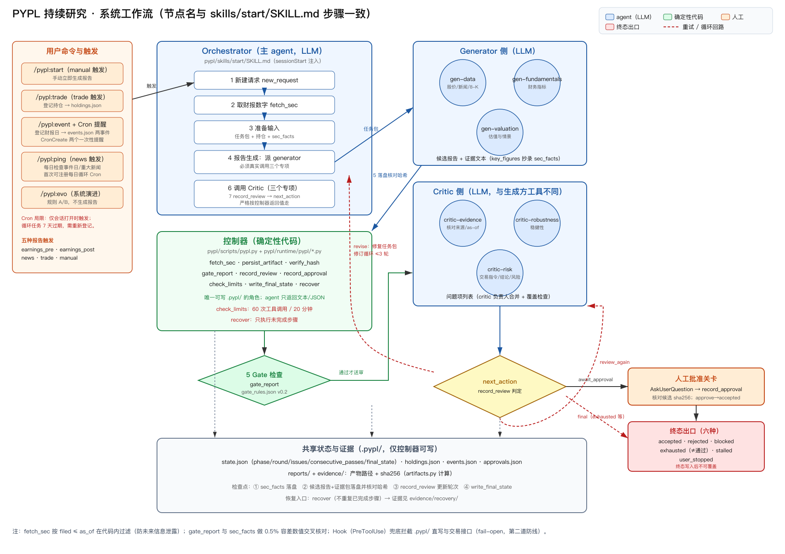
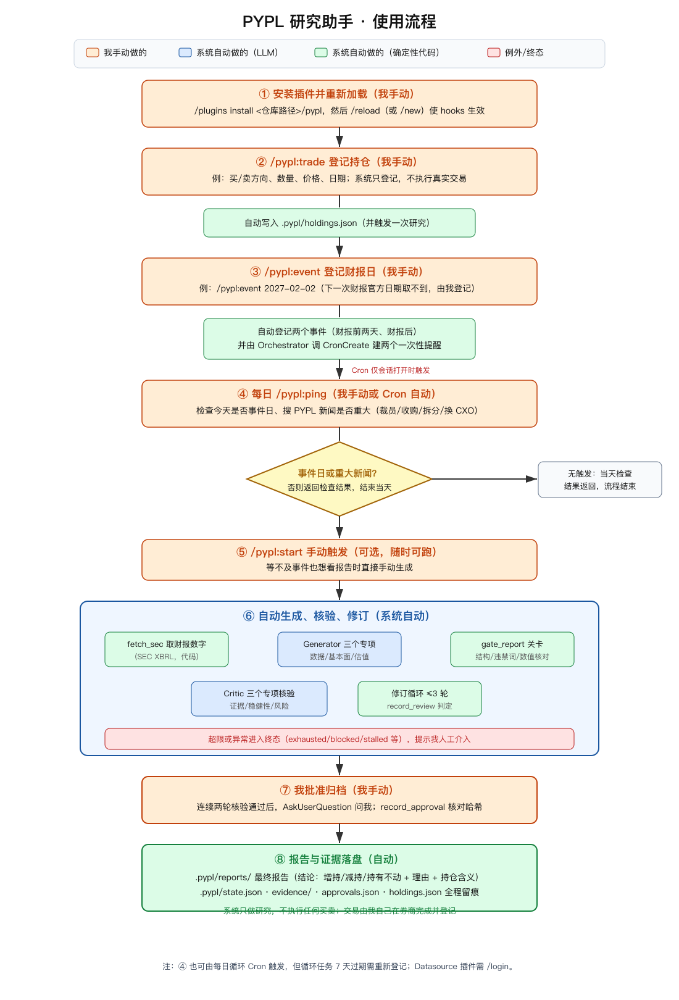

# 工作流图与注释

系统工作流见下图（源文件 `assets/workflow.svg`，导出 `assets/workflow.png`）：

## 注释

1. **入口与触发**：左侧橙色区是用户命令（`/pypl:start|trade|event|ping|evo`），其中报告触发五种：`earnings_pre`、`earnings_post`、`news`、`trade`、`manual`；Cron 提醒只在会话打开时触发、循环任务 7 天过期，这点在图上如实标注。
2. **两类执行体**：蓝色框是 LLM（Orchestrator 主流程、Generator 侧三个专项、Critic 侧三个专项），绿色框是确定性代码（控制器，唯一可写 `.pypl/`）；生成与核验两侧的工具白名单不同。
3. **关卡与循环**：候选报告先过确定性关卡 `gate_report`（含与 `sec_facts` 的数值交叉核对），送 Critic 后由 `record_review` 返回 `next_action`；`revise` 回路最多 3 轮，`review_again` 在同一候选上再审，`final` 直接进入终态出口（六种，exhausted 不等于通过）。
4. **检查点与共享状态**：`sec_facts`、候选报告与证据包落盘即记录 path+sha256；`state.json` 记录阶段、轮次、问题项、连续通过数和终态，恢复入口 `recover` 只执行未完成步骤（证据见 `evidence/recovery/`）。
5. **人工关卡**：连续两轮通过后由用户批准归档，`record_approval` 核对候选 sha256，approve→`accepted`、reject→`user_stopped`（证据见 `evidence/approval/`）。
6. **预算与安全**：控制器内 `check_limits` 限制 60 次工具调用 / 20 分钟；运行时另有 PreToolUse hook 兜底拦截 `.pypl/` 直写与交易接口（fail-open，仅第二道防线）。

用户使用流程见下图（源文件 `assets/usage-flow.svg`，导出 `assets/usage-flow.png`）：

